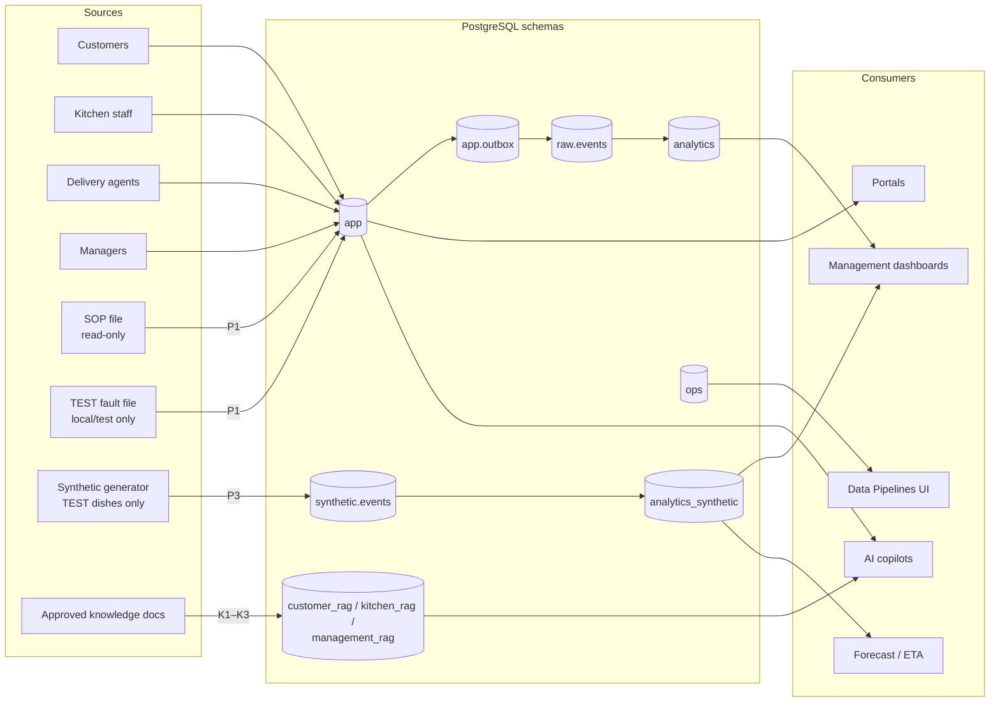
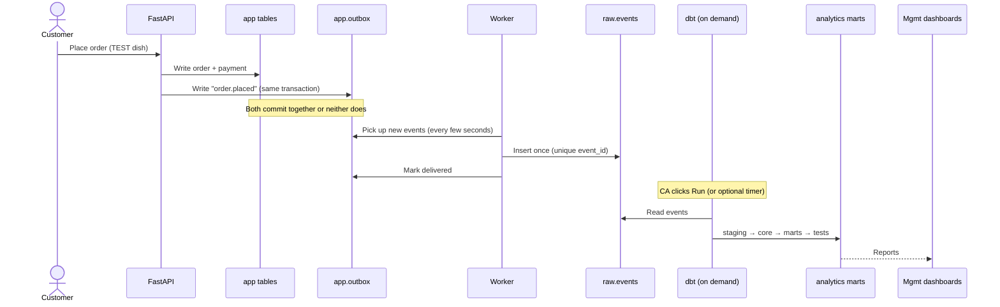
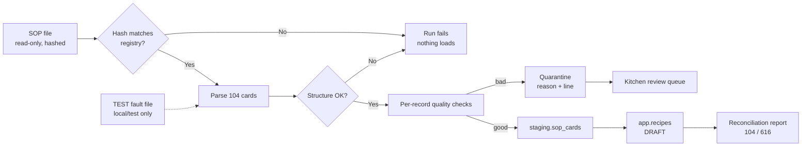
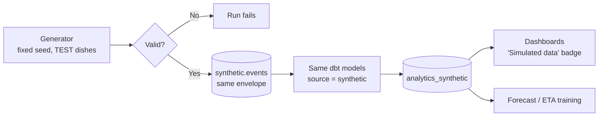
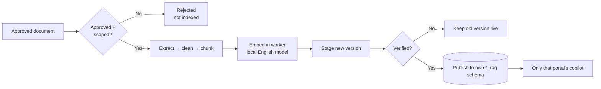
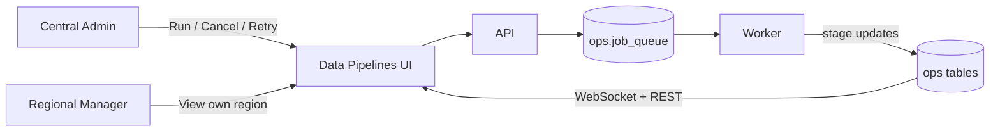

# DeliverIQ — Data Pipeline Design

**Version:** 1.1 (approved 2026-11-12; v1.1 adds AI maintenance jobs, §14)
**Status:** Approved design; implementation not started
**Related:** `DELIVERIQ_EXECUTION_PLAN.md` v2.6, `RAG_AI_DESIGN.md` (Tasks 3, 5, 9, 10, 12, 13, 14, 15, 16, 18, 20), `DOCKER_DEPLOYMENT_DESIGN.md`, `DESIGN_DECISION_REGISTER.md` (DDR-43, 46, 48, 50, 56, 57, 59, 63–67, 74–78), ETL spec DE-0…DE-11, `KITCHEN_SOURCE_VALIDATION.md`

---

## 1. Objective and scope

Working end-to-end pipelines operated from the Management "Data Pipelines" UI. Every status, count and error shown comes from real, persisted execution, never from simulated states.

| Pipeline | Purpose |
|---|---|
| P1 | SOP master-data ETL |
| P2 | Operational ELT (outbox → raw → dbt) |
| P3 | Synthetic data generation |
| K1–K3 | RAG ingestion for Customer, Kitchen and Management |

**Out of scope:** Dagster (DDR-59), external warehouses, streaming platforms.

## 2. Workflow charts

### 2.1 Big picture

### 2.2 Order flow (P2)

### 2.3 P1 SOP import

### 2.4 P3 synthetic data

Real and synthetic data never share a table. Only the dbt code is shared.

### 2.5 K1–K3 knowledge ingestion

Each K job connects with its own DB role.

### 2.6 Operation

## 3. Where data lives

| Schema | Holds | Written by | Read by | Nature |
|---|---|---|---|---|
| `app` | Users, menu, recipes, orders, payments, stock, deliveries, GPS points | API; P1 (recipes) | Portals, AI tools | Source of truth, live |
| `app.outbox` | One event per business change | API, same transaction | Worker | Hand-off point |
| `raw` | Every landed event | Worker (P2) | dbt | Append-only |
| `staging` | Typed events; parsed SOP cards | dbt; P1 | dbt; P1 | Intermediate |
| `analytics` | Dims, facts, marts from real events | dbt | Management dashboards | Read-only reports |
| `synthetic` | Simulated events (TEST dishes) | P3 | dbt | Labelled simulated |
| `analytics_synthetic` | Same marts from simulated events | dbt | Dashboards (labelled), ML | Labelled simulated |
| `ops` | Runs, stages, errors, quality results, source registry, job queue | Worker, API | Data Pipelines UI | Monitoring |
| `customer_rag`, `kitchen_rag`, `management_rag` | Chunks and vectors per portal | K1–K3, each with its own DB role | That portal's AI only | Isolated |
| `audit` | Who did what, when | API | Management | Append-only |

Portals always read live data from `app`. Only reports read `analytics`.

## 4. Sources and ingestion

| Pipeline | Source | Entry method | Trigger |
|---|---|---|---|
| P1 | Committed read-only SOP copy, hash-checked; TEST fault file (local/test only, DDR-65) | File read; hash compared with `ops.source_registry` | CA Run (UI/CLI) |
| P2 | `app.outbox` events written in the same transaction as the business change | Worker loop → `raw.events` | Landing continuous; dbt on demand or optional timer, off by default (DDR-66) |
| P3 | Seeded generator; TEST dishes only | Writes envelope-shaped events | CA Run |
| K1–K3 | Approved documents per portal | Read with each portal's own DB role | CA Run |

## 5. Stages

Each stage is persisted in `ops.pipeline_stage_runs` with counts and duration.

| Pipeline | Stages |
|---|---|
| P1 | register → parse → validate structure → transform (logged footer strip, whitespace/case only) → quality checks → stage → load DRAFT → reconcile → report |
| P2 | land → dbt staging → core → marts → dbt tests → publish freshness |
| P3 | generate → validate → write synthetic → dbt (synthetic source) → `analytics_synthetic` |
| K1–K3 | register → approval check → extract → normalize → chunk → embed (batched) → stage version → verify → atomic publish |

## 6. Data contracts

### 6.1 P1 parsed card

`menu_id`, `name`, `prep_type`, `portion`, `ingredients[] {name, quantity: Decimal, unit ∈ {g, ml, piece}, source_line}`, `method`, `quality`, `inventory_rule`, `validation_text`, `source_line_range`, `source_sha256`.

### 6.2 Event envelope (Harness blueprint §8.2)

`event_id`, `event_type`, `event_version`, `occurred_at`, `aggregate_type`, `aggregate_id`, `region_id`, `kitchen_id`, `correlation_id`, `idempotency_key`, `is_test_fixture`, `data`. No PII, OTPs or secrets.

### 6.3 Initial event types

| Group | Events |
|---|---|
| Order | `order.placed`, `order.accepted`, `order.rejected`, `order.cancelled`, `order.preparing`, `order.ready_for_pickup` |
| Payment | `payment.succeeded`, `payment.failed` |
| Inventory | `inventory.reserved`, `inventory.released`, `inventory.consumed` |
| Delivery | `delivery.assigned`, `delivery.picked_up`, `delivery.completed`, `delivery.failed` |

`delivery.completed` carries a GPS summary: `gps_distance`, `sample_count`, `gps_mode` (real/simulated), first and last timestamp. There are no per-point location events (DDR-78).

### 6.4 RAG chunk metadata

Per #3 §9, #6 §9 and #9 §9.

### 6.5 Run record

`pipeline`, `run_id`, `trigger` (ui/cli/timer), `actor`, `status` (queued, running, succeeded, completed_with_quarantine, failed, cancelled), `is_test`, `input_ref`, counts, timestamps, `error_summary`, `code_version`.

## 7. Validation and quality rules

| Pipeline | Rules |
|---|---|
| P1 | All 8 card fields present; ingredient line matches `name: qty unit`; qty > 0; unit in set; no name used with two units; duplicate/identical-BOM detection; unique menu IDs; 104/616 reconciliation; lineage on every row |
| P2 critical (fail run) | Keys unique/not-null; referential integrity; source-to-mart count reconciliation; zero fixture rows in real marts |
| P2 warning (record only) | Freshness; outbox backlog age |
| P3 | Deterministic seed; all rows flagged synthetic; TEST dishes only |
| K1–K3 | Approval, visibility and scope metadata required, otherwise reject; non-empty chunks; embedding dimension matches model; no cross-portal write (DB role) |

## 8. Transformations

- **P1:** only logged footer stripping and whitespace/case normalization. Values are never changed.
- **dbt staging:** typed, deduplicated events.
- **dbt core:** `dim_date`, `dim_kitchen`, `dim_region`, `dim_menu_item`, `dim_ingredient`, `fact_orders`, `fact_order_items`, `fact_payments`, `fact_inventory_movements`, `fact_kitchen_stage_events`, `fact_deliveries`.
- **Marts (DDR-75):** `mart_daily_sales`, `mart_menu_performance`, `mart_kitchen_performance`, `mart_inventory_consumption`, `mart_delivery_performance`, `mart_payment_performance`. Deferred: customer experience, operational exceptions.
- **KPI formulas:** from ETL spec §9, labelled "definition pending approval" until DDR-44.
- **Real vs synthetic:** the same models build `analytics` (source `raw`) and `analytics_synthetic` (source `synthetic`), selected by a dbt variable (DDR-74).

## 9. Storage and retention

- All in PostgreSQL, in separate schemas (DDR-25, decided).
- Run history kept indefinitely (DDR-67).
- GPS points only in `app.delivery_locations`, with the 30-day retention job. Analytics uses per-delivery summaries, so `raw` remains append-only (DDR-78).
- Synthetic data includes a few full GPS tracks for the map demo.
- dbt `run_results.json` is parsed into `ops.dq_results`.

## 10. Errors and retries

DDR-67 rules apply, plus:
- P1 record errors go to `ops.ingestion_errors` and the review queue.
- Unparseable P2 raw events are kept with `parse_status = rejected` and shown in the UI; never deleted.
- K publishing is atomic: the previous version stays live on failure.

## 11. Execution

- PostgreSQL job queue, claimed with `SELECT … FOR UPDATE SKIP LOCKED`.
- Single heartbeating worker.
- A semaphore allows one heavy job (dbt, embedding) at a time; event landing continues alongside.
- Worker timer for the optional P2 schedule.
- CLI `deliveriq pipelines run <name>` uses the same entry points as the UI.

## 12. Data Pipelines UI (Management)

| View | Content |
|---|---|
| Overview | Data and Knowledge groups; last status; freshness; P2 outbox backlog and oldest-event age |
| Pipeline detail | Run (CA only); P2 schedule toggle (CA only); run history |
| Run detail | Live stage timeline, counts, durations, errors, quarantine, dq results, P1 report download |
| Quarantine | P1 quarantined records with reasons |
| Knowledge approval (DDR-76) | Customer and Management documents approved by CA; Kitchen documents approved by KM; approval audited |

- The Kitchen review queue lives in the Kitchen portal.
- Every view has loading, empty, error and denied states and shows persisted data only.
- Permissions (DDR-64): CA runs, cancels, retries and views all; RM views own region with no action controls; others denied. Enforced in the backend.

## 13. Tests and acceptance

| Area | Tests |
|---|---|
| P1 | Real SOP gives 104 cards and 616 ingredient lines; re-run adds zero rows; fault file quarantined with correct reasons; structural fault loads nothing; production rejects fault runs |
| P2 | Duplicate `event_id` gives one raw row; killed worker loses no events; critical test failure leaves marts not fresh; replay doesn't double count; no location events in raw |
| P3 | Same seed gives identical output; zero leakage into real marts |
| K1–K3 | RM cannot trigger; kitchen role cannot write `customer_rag`; failed publish keeps the old version; unapproved document not indexed; production refuses fixture chunks in `kitchen_rag` |
| UI | Playwright runs P1 from the UI and verifies persisted counts; RM view-only scope; knowledge approval by the correct role only |

## 14. Resources, alternatives and open items

**Resources (estimates, to measure):** dbt `threads` 2, on demand; embedding in batches; one heavy job at a time.

**Alternatives considered:**

| Rejected option | Reason |
|---|---|
| Synthetic data as direct tables | Skips the transformations |
| Synthetic mixed into raw with a flag | Leak risk |
| Full-rate GPS events | Conflicts with 30-day retention |
| Dagster | Dropped (DDR-59) |

**AI maintenance jobs (v1.1, per `RAG_AI_DESIGN.md`):** embedding benchmark run (DDR-89), versioned K re-index when the embedding model changes (DDR-88), and the conversation/AI-request retention purge (DDR-91). All run on this framework and appear in `ops.pipeline_runs`.

**Open items:** DDR-44 KPI definitions; DDR-45 embedding winner (benchmark, DDR-89); DDR-46 owner approval of drafted documents and golden sets.
