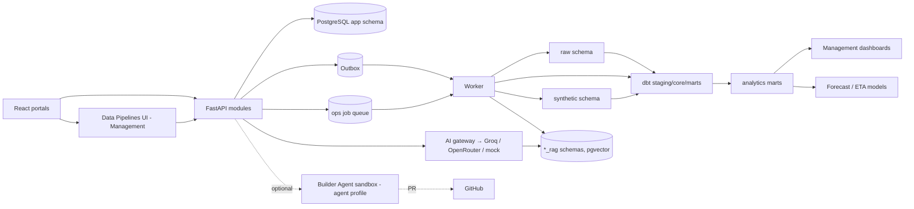
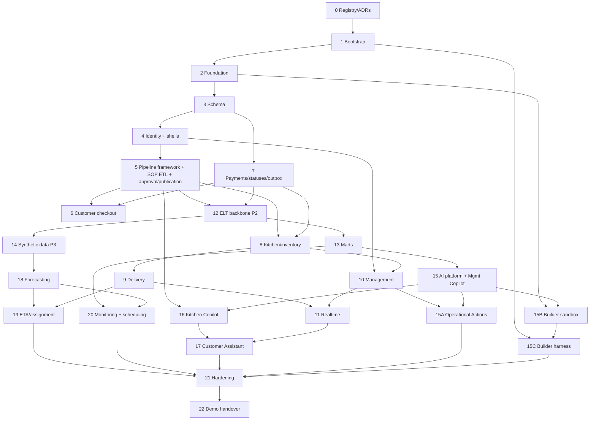

# DeliverIQ — Execution Plan

**Version:** 2.6 (aligned with `DESIGN_DECISION_REGISTER.md` incl. owner decisions of 2026-11-12: DDR-16 closed, DDR-49–DDR-94)
**Status:** Approved sequence; implementation not started. Docker/deployment, data pipeline, code structure and RAG/AI designs approved.
**Companion documents:** `SOURCE_DOCUMENT_INVENTORY.md`, `PORTAL_REQUIREMENTS_MATRIX.md`, `DESIGN_DECISION_REGISTER.md` (DDR-nn), `KITCHEN_SOURCE_VALIDATION.md`, `DOCKER_DEPLOYMENT_DESIGN.md`, `DATA_PIPELINE_DESIGN.md`, `CODE_STRUCTURE_DESIGN.md`, `RAG_AI_DESIGN.md`

---

## 1. Problem statement

Build a production-grade single-kitchen (Chennai) cloud-kitchen platform with four role-based portals, a credible ETL/ELT data platform and a POC-level GenAI/ML layer, running on a 16 GB Ubuntu 24.04 laptop. The POC is a portfolio/interview demo (DDR-49).

## 2. Confirmed baseline

| Area | Decision | Ref |
|---|---|---|
| POC purpose | Portfolio/interview demo; production-only blockers become known limitations | DDR-49 |
| Frontend | React + TypeScript + Vite + Tailwind + shadcn/ui; one app, role-protected portal routes | DDR-03 |
| Delivery app | Installable PWA; GPS points buffered offline; no offline action queue; background geolocation open | DDR-15, DDR-52 |
| Backend | Python + FastAPI modular monolith; SQLAlchemy 2.x; Alembic | Requirements spec |
| Data | PostgreSQL + PostGIS + pgvector; Redis; WebSockets | Requirements spec |
| Maps | Leaflet + OpenStreetMap; road distance behind an adapter (stub daily, optional local Chennai OSRM) | PL-15, DDR-55 |
| AI | Provider-neutral OpenAI-compatible gateway; Groq default, OpenRouter addable by config; `gpt-oss-20b` for Copilots and Actions, `gpt-oss-120b` for Builder; CA runtime switch to configured models. Customer, Kitchen and Management Copilot read-only; Management Operational Actions and Builder Agent CA-only | DDR-18, DDR-68, DDR-85–87 |
| Embeddings | Adapter; local CPU English model in the worker, int8 ONNX, chosen by benchmark with a fixed pass bar | DDR-57, DDR-88, DDR-89 |
| AI evaluation and memory | Medium golden sets, zero-leak release gate; 6-turn memory, 30-day retention; Prompt Guard on Customer input | DDR-90–92 |
| Language | English only for RAG and evaluation | DDR-58 |
| Data engineering | Python CLI + dbt Core on PostgreSQL; no Dagster; shared pipeline-runs framework; `synthetic` schema | DDR-20, DDR-59, DDR-63 |
| Deployment | Docker Compose with profiles; local first, cloud-portable | DDR-62 |
| Version control | GitHub + GitHub Actions; committed source copies hash-checked in CI | DDR-60 |
| Testing | pytest, Vitest, Playwright (+ axe-core, device emulation, screenshot regression) | DDR-24 |
| Palettes | Customer B, Delivery A, Kitchen, Management | DDR-01, 02, 04, 05 |
| Statuses | Canonical fulfilment/payment/assignment/item machines with display mapping | DDR-17 |
| Recipes | Import as DRAFT; KM is final activation authority; five sign-offs are audit records (PO records PO sign-off, KM the rest); **no SOP recipe is activated in the POC** | DDR-09, DDR-10, DDR-50, DDR-54 |
| Demo menu | Only `TEST –` synthetic dishes are published and ordered | DDR-48, DDR-50 |
| Menu publication | CA in any region; RM in assigned regions only; readiness checklist + ACTIVE recipe; audited | DDR-11, DDR-31 |
| Assignment | Agent assigned at kitchen acceptance; "Agent Assigned" shown immediately; never changes fulfilment status | DDR-16, DDR-51 |
| `OUT_FOR_DELIVERY` | Automatic after validated pickup, same transaction | DDR-16 |
| Coupon vs minimum | ₹500 checked on food subtotal before coupon; coupon may bring payable total below ₹500 | DDR-53 |
| Duplicates | MENU008/MENU057 imported and quarantined; disposition non-blocking | DDR-13, DDR-35 |
| Delivery fee | ₹30 flat per order; no free-delivery threshold | DDR-38 |
| Special instructions | 250 characters, UI + backend | DDR-07 |
| Unavailable-customer wait | Configurable, default 5 min | DDR-14 |
| GPS retention | 30 days, then delete or irreversibly anonymise | DDR-43 |
| Opening stock | Test-only, labelled | DDR-37 |
| Kitchen location | Unavailable; labelled synthetic fixture | DDR-39 |
| Synthetic data | Demo seed 7 days × 10 orders/day; ML set 90 days × 30 orders/day | DDR-56 |
| Synthetic analytics | Same dbt models; separate `analytics_synthetic` schema | DDR-74 |
| Marts | Daily sales, menu, kitchen, inventory, delivery, payment | DDR-75 |
| Knowledge content | Drafted by Kiro from source rules; approved in-app (CA: Customer/Management; KM: Kitchen) | DDR-76 |
| GPS in analytics | Per-delivery summary on `delivery.completed`; points stay in `app` only | DDR-78 |
| Host setup | Kiro CLI during build; owner confirms shell/user config changes | DDR-79 |
| Code structure | Domain modules with thin layers; import-linter; feature and harness README cards | DDR-80 |
| API contract | OpenAPI-generated TS client, committed; CI drift check | DDR-81 |
| Data access | Sync SQLAlchemy 2.x + psycopg 3; async only for WebSockets, Redis, outbound HTTP | DDR-82 |
| Dependencies | uv (`pyproject.toml` + `uv.lock`, groups api/worker/dev); npm lockfile | DDR-83 |
| Frontend routing | React Router | DDR-84 |
| AI/ML order | Management → Kitchen → Customer → Forecasting → ETA/assignment | DDR-19 |
| Real recipe source | `/home/k/Downloads/task1/kitchen/original/Kitchen_SOP_Manual_Token_Friendly.md` (SHA-256 `7ee63f62…bfc19211`) | Inventory #13 |
| Excluded | Kubernetes, Kafka, MongoDB, Dagster, local LLM, real payments, earnings, delivery chatbot, `EIB Data.xlsx` | Requirements spec, DDR-59, DDR-61 |

## 3. Memory budget

Estimates only; measured with `docker stats` and `free -h` at every task gate. Target: ≥ 2 GB headroom on the 16 GB laptop.

| Compose profile | Services | When it runs |
|---|---|---|
| `core` | PostgreSQL, Redis, API | Daily |
| `worker` | Pipeline worker (job queue, event landing, dbt subprocess, embedding model) | When running pipelines |
| `osrm` | Local OSRM, Chennai-city extract | Road-rule tests and demos only |
| `e2e` | Playwright browsers | E2E runs only; heavy suites run in GitHub Actions |
| `agent` | Builder Agent sandbox | On demand, destroyed after each task |

Measures (DDR-62): PostgreSQL `shared_buffers` 256MB, `work_mem` 4MB, `max_connections` 20, `maintenance_work_mem` 64MB; Redis `maxmemory` 64mb, no persistence; one Uvicorn worker in dev; Vite runs on the host (no frontend container in dev); embedding model loads only in the worker and is released after ingestion; dbt `threads` 2, on demand; Playwright Chromium only, headless, 2 workers; `mem_limit` set only after measurement.

## 4. Architecture overview

### 4.1 Milestones

| Milestone | Tasks | Demo story |
|---|---|---|
| M1 Foundation | 0–4 | Login per role, four themed shells |
| M2 Core order flow | 5–9 | SOP import with pipeline UI, plus a `TEST –` order from checkout through kitchen to delivery |
| M3 Ops & data | 10–14 | Management portal, live updates, dbt marts, synthetic history |
| M4 AI | 15, 15A, 15B, 15C, 16, 17 | Management Copilot, Operational Actions, Builder Agent, Kitchen Copilot, Customer Assistant |
| M5 ML & polish | 18–22 | Forecast, ETA, hardening, demo handover |

### 4.2 Pipeline framework summary

One shared pipeline-runs framework (DDR-63) runs:
- **Data group:** P1 SOP master-data ETL, P2 operational ELT, P3 synthetic generation.
- **Knowledge group:** Customer, Kitchen and Management RAG ingestion.

Key points:
- PostgreSQL job-queue table and a single worker container; dbt runs as a subprocess.
- Tables: `ops.pipeline_runs`, `ops.pipeline_stage_runs`, `ops.ingestion_errors`, `ops.dq_results`, `ops.source_registry`.
- Each job connects with its own per-pipeline DB role.
- Permissions (DDR-64): CA triggers, cancels, retries and views all; RM views own-region runs; all others denied.
- P1 fault injection with a TEST-only file, local/test only (DDR-65).
- P2 hybrid: continuous event landing, on-demand dbt, optional schedule off by default (DDR-66).
- Operating rules: retries, partial failure, dbt test severity, concurrency, cancel, history, contracts, live status, CLI-only reset (DDR-67).
- The UI shows stages, status, counts, errors, quarantine and run history from persisted records; the CLI uses the same entry points.

---

## 5. How open decisions affect tasks

| Class | Meaning | Rule |
|---|---|---|
| **B — Build** | The named component cannot be implemented correctly without the answer | Do not implement that component; implement everything around it |
| **A — Activation** | Code can be built and tested; real data or a feature cannot be switched on | Build behind a disabled flag or empty state; tests use labelled fixtures |
| **P — Production** | Development and tests proceed with labelled fixtures/adapters; production configuration or real-world claims are blocked | Fixture clearly labelled; listed as a known limitation in Task 22 |
| **G — Gate** | A proposal must be approved before the task that uses it starts | Approve or amend the proposal at the task's entry gate |

**Out of POC scope** (DDR-49): DDR-08, DDR-32, DDR-39, DDR-40 and DDR-47 do not block any task. They use labelled placeholders and are listed as known limitations at handover. DDR-33–DDR-36 are non-blocking data-quality items because no SOP recipe is activated (DDR-50).

### 5.1 Decision-to-task matrix

| DDR | Open item | Class | Task(s) | What proceeds | What is blocked |
|---|---|---|---|---|---|
| DDR-06 | Food-card Add behaviour | B | 6 | Menu, dish detail, cart, checkout | The food-card Add interaction only |
| DDR-15 | Background geolocation | B (scope) | 9 | Installable PWA; online-only actions; GPS buffering (DDR-52) | Background GPS is not built |
| DDR-41 | Lost-mobile recovery safeguards | B | 4 | All other auth flows | The recovery flow only |
| DDR-42 | Kitchen defaults | A | 8 | Configurable values with labelled test defaults (capacity 10 is the source test value) | Final values |
| DDR-43 | GPS sampling interval | A | 9 | Configurable 3–5 s | Final interval |
| DDR-44 | Refund thresholds; KPI formulas; audit retention/export; YAML editor vs upload | B / A | 10, 13, 15A | Refund workflow with thresholds unset (exceptional-refund rule disabled); dbt models built; audit log | YAML editing component (B); presenting KPIs as business truth (A); exceptional-refund action (A) |
| DDR-45 | Embedding model winner (benchmark, DDR-89) | B | 16 | Embedding adapter; benchmark run | Vector column dimension and indexing |
| DDR-46 | Approved RAG content and golden sets | A | 15, 16, 17 | Ingestion pipelines with DRAFT stubs | Publishing any knowledge to a live collection |

Resolved since v2.2 and removed from this matrix: DDR-16 (`OUT_FOR_DELIVERY` automatic after pickup). Resolved in v2.6: G gates DDR-21–25 and 27–29 (approved as written), DDR-26 (superseded by DDR-85), DDR-72 (DDR-86), DDR-73 (DDR-93), the LLM part of DDR-45 (DDR-86). Reclassified as out of POC scope: DDR-08, 32, 39, 40, 47. Reclassified as non-blocking: DDR-33–36.

### 5.2 Synthetic test menu items (decided — DDR-48, DDR-50)

Tasks 6–9 run end-to-end workflow tests using synthetic `TEST –` menu items. Real SOP dishes are not published in this POC.

**Rules**
- Display name prefix `TEST –`; obviously synthetic test prices.
- Independently created records. Never copied, derived, renamed or adapted from the Kitchen SOP. The SOP remains the only real recipe source.
- Exist only in local/test databases.
- Test recipes, opening stock, orders, order items and simulated payments that use them are flagged `is_test_fixture = true` and labelled "Test" in every UI.

**Leak controls (all must pass; verified in Tasks 3, 5, 6, 12, 16, 22)**
1. `is_test_fixture` column on `menu_items`, `recipe_versions`, `orders`, `order_items`, `payments`; set only by the fixture loader; not writable through any API.
2. Fixture loader refuses to run unless `APP_ENV` is `local` or `test`.
3. Production-profile startup check fails if any `is_test_fixture = true` row exists.
4. Production-profile customer menu and checkout queries filter `is_test_fixture = false` (defence in depth).
5. Production seed files contain no fixture rows (test asserts this).
6. dbt real models exclude fixture rows; test asserts zero fixture rows in real marts.
7. Test asserts no fixture menu-item name, normalized, matches any of the 104 SOP dish names.
8. Production-profile Kitchen RAG refuses `is_test_fixture` chunks (DDR-77).

### 5.3 Prerequisites to collect later

Requested only when the task needs them. Secrets go in a git-ignored local `.env` or GitHub Actions secrets; never in code, Git, docs or chat.

| Item | Needed for |
|---|---|
| GitHub repository + local authentication: **done** — public repo `https://github.com/ki957/deliveriq`, SSH via host alias `github-kiro` (remote `git@github-kiro:ki957/deliveriq.git`; other clones may use `git@github.com:`) | Task 1 |
| Groq API key (free tier) in local `.env`; its rate limits recorded in `ai_models.yaml` | Task 15 (live calls only) |
| Optional: OpenRouter (or other OpenAI-compatible) API key in local `.env` | Any time after Task 15; config only |
| GitHub fine-grained token scoped to repository contents + pull requests, in local `.env` / Actions secrets | Task 15C |
| Branch protection on `main` | Task 15C |
| One-time downloads: embedding model, Chennai OSM extract | Tasks 9, 16 |

---

## 6. Cross-cutting acceptance criteria (every UI task from Task 4)

| Requirement | Evidence |
|---|---|
| Source traceability: every imported value links to file, hash, line | `ops.source_registry`; row-level source columns |
| Accessibility: contrast, keyboard navigation, visible focus, labels, status not colour-only | axe-core Playwright checks per screen; manual keyboard pass |
| Mobile-first: Delivery and Customer on phone viewports (e.g. 360×800, 390×844) plus tablet | Playwright device projects |
| Visual regression: baseline screenshots per portal screen and breakpoint | Playwright `toHaveScreenshot`; baselines committed |
| Loading, empty, error, permission-denied, success states | Component tests |
| Simulated/test data visibly labelled (GPS, road-distance stub, payments, stock, `TEST –` menu items, test orders, synthetic history) | UI review checklist + Playwright assertion on badges |
| Negative authorization tests at API level | pytest suite |
| Memory measured | `docker stats` snapshot in task report |
| Module boundaries respected | `import-linter` passes in CI (DDR-80) |
| API contract in sync | Generated TS client up to date; CI drift check passes (DDR-81) |
| Feature/harness README card present and current | Card in the feature or harness folder (DDR-80) |
| Code review completed | `CODE_STRUCTURE_DESIGN.md` §13 checklist; findings graded Blocker/High/Medium/Low; no open Blocker or High |

---

## 7. Task breakdown

Each task lists **Depends on** (tasks and decisions), **Acceptance criteria** (must pass to close the task) and **Gated features** (built but disabled, or not built, per §5).

### Task 0 — Source registry, hashing and ADRs

- **Objective:** Make every source verifiable and every decision recorded.
- **Status:** Implemented on branch `task-00-source-registry` (2026-11-12), awaiting owner review. Registry check `backend/app/cli/source_registry.py` (reads expected values from the inventory), 21 copies in `data/source/` with `data/SOURCE_PROVENANCE.md`, CI job `source-integrity`, 25 ADRs in `docs/adr/`. The write to `ops.source_registry` is added with the pipeline framework in Task 5, because `ops` tables exist only from Task 3.
- **Remaining guidance:** automated re-runnable registry script writing to `ops.source_registry` and comparing against recorded values; approved read-only copies committed under `data/source/` with the filename-resolution table and provenance; CI job verifying committed copies against recorded SHA-256 (DDR-60); ADRs from register Part D. `EIB Data.xlsx` is excluded (DDR-61).
- **Depends on:** working shell (available).
- **Acceptance criteria:**
  - Registry script reproduces the recorded hashes exactly; modifying a copy is detected.
  - CI fails if a committed source copy's hash differs from the inventory.
  - Originals under `/home/k/Downloads/task1/` unchanged (hashes still match).
  - Hash verification stays separate from content validation.
  - Every ADR in register Part D exists with status.

### Task 1 — Repository bootstrap

- **Status:** Task 0 merged (PR #1). Task 1 implemented on branch `task-01-repo-bootstrap` (2026-11-12), awaiting owner review. Runtime dependency groups `api` and `worker` are defined empty and filled by Tasks 2 and 5; `frontend/package.json` has no dependencies until the Task 4 scaffold. Docker Makefile targets are added in Task 2.
- **Depends on:** Task 0; GitHub repository + local auth (§5.3).
- **Acceptance criteria:** Repository layout per `CODE_STRUCTURE_DESIGN.md` §2; `pyproject.toml` + `uv.lock` with groups `api`, `worker`, `dev` (DDR-83); `package.json` + committed `package-lock.json`; `.gitignore` excludes `.env`; `.env.example` has placeholders only; steering file references the planning docs.

### Task 2 — Engineering foundation

- **Status:** Task 1 merged (PR #2). Task 2 implemented on branch `task-02-engineering-foundation` (2026-11-12), approved by owner. Four approved deviations recorded in `DOCKER_DEPLOYMENT_DESIGN.md` v1.4 §17 (Postgres base image, host port 5433, `edge` network, profiles added per task). Idle `core` memory ≈ 121 MiB.
- **Depends on:** Task 1; DDR-28 (decided); approved `DOCKER_DEPLOYMENT_DESIGN.md`.
- **Guidance:** Compose profiles `core`, `worker`, `osrm`, `e2e`, `agent` (DDR-62); no Dagster, MinIO or MongoDB; Vite on the host in dev. Follow `DOCKER_DEPLOYMENT_DESIGN.md`. Host setup is performed by Kiro CLI; changes to the owner's shell/user configuration require owner confirmation at the time (DDR-79).
- **Acceptance criteria:**
  - `core` profile starts PostgreSQL (PostGIS + pgvector verified), Redis and the API; other profiles start only on request.
  - PostgreSQL and Redis settings per DDR-62.
  - Health and readiness endpoints pass; correlation IDs appear in logs.
  - CI runs lint, type check and tests, plus `import-linter` dependency rules (DDR-80) and the OpenAPI client drift check (DDR-81).
  - `APP_ENV` (`local`, `test`, `production`) defined and validated at startup.
  - Memory baseline recorded per profile.

### Task 3 — Data model and migrations

- **Status:** Task 2 merged (PR #3). Task 3 implemented on branch `task-03-data-model` (2026-11-12), approved by owner, including five values not defined by sources: sign-off codes `CHEF`/`FOOD_SAFETY_LEAD`/`INVENTORY_OWNER`/`KITCHEN_MANAGER`/`PRODUCT_OWNER`; kitchen modes `NORMAL`/`BUSY`/`PAUSED` and user statuses `ACTIVE`/`SUSPENDED`/`DEACTIVATED`; `SUPERSEDED` and `DISABLED` as separate recipe states; reasons required for refund request and COD mismatch; money in integer paise. Migrations 0001–0005; policy in `backend/migrations/README.md`. Columns are limited to what the state machines, leak controls and acceptance need; checkout/money (Tasks 6–7), stock (8), GPS (9), identity sessions/OTP (4) and RAG tables (15–17) are added by the tasks that own them.
- **Depends on:** Task 2; DDR-25, DDR-27, DDR-29 (decided).
- **Guidance:**
  - Schemas per DDR-25.
  - Canonical status machines (DDR-17) as constrained enums plus transition rules. `PICKED_UP → OUT_FOR_DELIVERY` is automatic (DDR-16). Assignment status lives on `delivery_assignments` and has no write path to `orders.fulfilment_status`.
  - Recipe states (DDR-10) and a sign-off table with exactly five required sign-off types.
  - Menu publication states (DDR-11), readiness fields and a publication audit table (actor, role, region, timestamp, menu item, action).
  - `is_test_fixture` columns per §5.2.
  - Source-lineage and quarantine columns.
  - Pipeline tables and job queue (DDR-63); per-pipeline DB roles, including one role per RAG schema.
  - Audit tables for Operational Actions and Builder Agent proposals, as needed (DDR-69, DDR-70).
  - Config seeds: `CUSTOMER_UNAVAILABLE_WAIT=5 min`, `DELIVERY_FEE_FLAT=30 INR`, `SPECIAL_INSTRUCTIONS_MAX_CHARS=250`, `GPS_RETENTION_DAYS=30`, `GPS_UPDATE_INTERVAL_MIN/MAX=3/5 s`, `MAX_CONCURRENT_ORDERS=10 (test)`; no free-delivery threshold key.
  - Kitchen location seeded only as the labelled synthetic fixture.
- **Acceptance criteria:**
  - Fresh database migrates from empty; downgrade/forward-fix policy documented.
  - Illegal fulfilment, payment, assignment, item and recipe transitions are rejected.
  - A recipe cannot reach `ACTIVE` without five sign-off rows.
  - A menu item cannot reach `PUBLISHED` unless linked to an `ACTIVE` recipe version.
  - Changing an assignment's status never changes `fulfilment_status`.
  - `is_test_fixture` is present on all five tables and not updatable via the application role.
  - Each per-pipeline DB role can write only its own target schema.
  - Production seed contains zero fixture rows; no free-delivery threshold setting exists; kitchen fixture flagged synthetic.

### Task 4 — Identity, RBAC and portal shells

- **Status:** Task 3 merged (PR #4). Decision sheet approved (DDR-95–DDR-100). Delivered as **4A** (backend identity, sessions, RBAC; branch `task-04-identity-shells`) and **4B** (frontend scaffold and shells). 4A approved by owner with two clarifications of DDR-98/99: session cookies are Secure in production only (local and test run over plain HTTP), and the test-only scope router is mounted in `local` and `test` (never production). 4A merged (PR #5). 4B implemented on branch `task-04b-portal-shells` (2026-11-12), awaiting owner review: frontend scaffold, generated API client, shared login, four shells, `e2e` Compose profile with pinned Playwright, 13 screenshot baselines, CI `frontend` and `e2e` jobs.
- **Depends on:** Task 3; DDR-21, DDR-22, DDR-23, DDR-24 (decided). Concrete status-colour values are shown to the owner for review (DDR-21).
- **Gated features:** lost-mobile recovery (B, DDR-41). Placeholders (out of POC scope): MOCK_OTP instead of real SMS (DDR-40), labelled wordmark (DDR-08), "image unavailable" state (DDR-47).
- **Acceptance criteria:**
  - OTP hashed, expiring, rate-limited, never logged; MOCK_OTP refuses to start outside local/test.
  - Roles and region/kitchen scope enforced server-side; role removal revokes sessions; 7-day trusted devices revocable.
  - Negative matrix passes: cross-customer, cross-kitchen, cross-region, KS→KM-only actions, RM→CA-only actions.
  - Four shells with per-portal themes; placeholder wordmark labelled as placeholder.
  - axe passes on every shell; screenshot baselines committed; Customer and Delivery shells pass phone-viewport tests.
  - Recovery route is absent (not stubbed as working).
  - Frontend uses the generated API client (DDR-81); portal route guards use React Router (DDR-84) and backend `/me/permissions`.

### Task 5 — Pipeline framework, SOP ETL (P1), approval and publication workflows

- **Depends on:** Tasks 0 (registry), 3, 4.
- **Guidance:**
  - Per `KITCHEN_SOURCE_VALIDATION.md` §7–9.
  - Build the shared pipeline framework runtime and worker (DDR-63, DDR-67); P1 runs on it.
  - P1 fault-injection TEST file written from scratch, with `APP_ENV` guard (DDR-65).
  - Initial Data Pipelines UI: CA can run, cancel and retry; RM views own-region runs (DDR-64).
  - Fixture loader for DDR-48 `TEST –` items lives in a separate test-only module, not in the SOP import.
  - Activation workflow demonstrated on TEST recipes only (DDR-50, DDR-54).
- **Acceptance criteria:**
  - Framework:
    - Runs, stages, errors and quality results persisted in `ops.*`; the UI shows them from the database, not hardcoded states.
    - One active run per pipeline; transient errors retry up to 3 times; data failures never auto-retry; cancel works at stage boundaries.
    - RM calling trigger/cancel/retry directly gets 403; non-management roles cannot read runs.
  - Import:
    - All 104 cards imported as `DRAFT`; re-import adds zero rows and yields an identical report.
    - Every recipe and component row stores file, SHA-256, line range and card ID.
    - MENU008 and MENU057 both present as `QUARANTINED_DUPLICATE_CANDIDATE`; neither deleted nor merged.
    - Missing components (8) and ambiguities appear in the review queue with reasons.
    - Report states the unavailable Excel/PDF limitation.
    - Counts recorded and matching source claims (104 cards; 616 ingredient lines).
    - SOP import never sets `is_test_fixture`.
  - Fault injection:
    - Fault run shows quarantined records with reasons and status "Completed with quarantine"; a structural fault fails the run with nothing loaded.
    - Backend rejects fault-injection runs when `APP_ENV` is `production`; the file is not in production images; fault runs are flagged as test.
  - Recipe approval:
    - Only KM can execute `VALIDATED → ACTIVE`; KS, RM and CA cannot.
    - Activation fails if any of the five sign-off records is missing; recording five sign-offs without KM action does not activate.
    - Quarantined or ambiguity-flagged recipes cannot be submitted.
    - Every transition audited with actor, role, timestamp, reason.
    - **No SOP recipe ever reaches `ACTIVE`** (test asserts this).
  - Menu publication (DDR-31):
    - CA can publish in any region. RM can publish only in assigned regions. KM, KS, Delivery Agent and Customer cannot publish.
    - Backend rejects RM publication outside assigned regions even when called directly (UI bypass test).
    - UI shows the publish control only to RM (assigned regions) and CA; hiding is not the only control.
    - Publication fails for both roles unless every readiness field is present and the recipe version is `ACTIVE`; neither role can bypass activation.
    - Every publication writes an audit record with actor, role, region, timestamp, menu item and action.
    - Unpublished items are invisible to customer APIs.

### Task 6 — Customer menu, cart and checkout

- **Depends on:** Tasks 5, 7 (payment simulation for the place-order step); DDR-48 fixtures for end-to-end tests.
- **Gated features:** food-card Add interaction (B, DDR-06). Placeholders: synthetic kitchen location (DDR-39), "image unavailable" (DDR-47).
- **Acceptance criteria:**
  - Public menu shows only `PUBLISHED` items; filters (price, veg, spice, popularity) work.
  - End-to-end checkout runs on `TEST –` items in the test environment; test orders and simulated payments are flagged and labelled "Test".
  - In a production-profile test database, the customer menu returns no fixture rows and the ordering API rejects fixture item IDs.
  - Serviceability requires both ≤ 4 km straight-line and ≤ 6 km road distance. Road distance goes through the adapter: labelled stub by default; road-rule tests run with the `osrm` profile (DDR-55).
  - ₹499 rejected, ₹500 accepted; ₹500 check runs on food subtotal before coupon; a coupon may bring the payable total below ₹500 (DDR-53).
  - Delivery fee is ₹30 at every subtotal; no waiver path exists.
  - Special instructions: 250 accepted, 251 rejected by the backend even if the UI is bypassed.
  - 30-minute price protection; changed price requires explicit confirmation; accepted price stored on the order.
  - Unavailable item removed with customer confirmation.
  - Phone, tablet and desktop Playwright runs; axe; screenshots.

### Task 7 — Payments, order state machines and outbox

- **Depends on:** Task 3.
- **Acceptance criteria:**
  - Simulated UPI/card (`SUCCESS`, `FAILED`, `TIMEOUT`) and COD (`COLLECTION_PENDING`, `COLLECTED`, `MISMATCH`) behave per #15 §9; payments on fixture orders carry `is_test_fixture`.
  - Prepaid failure or timeout never reaches `PENDING_KITCHEN`; COD reaches it directly.
  - Duplicate submissions create one order and one payment.
  - Business row and outbox event commit atomically; a crash after commit does not lose the event.
  - Display mapping returns the labels in `PORTAL_REQUIREMENTS_MATRIX.md` §7.3 for every state.
  - **Agent Assigned:** for fulfilment `ACCEPTED`, `PREPARING` or `READY_FOR_PICKUP` with assignment `ACCEPTED`, the customer view returns the unchanged fulfilment label **plus** the "Agent Assigned" indicator.
  - Assignment events never change `fulfilment_status`; no code path enters `PICKED_UP` or `OUT_FOR_DELIVERY` from assignment.
  - **`OUT_FOR_DELIVERY`** is entered automatically after a validated pickup, in the same transaction as `PICKED_UP`; never from assignment (DDR-16).

### Task 8 — Kitchen operations and inventory

- **Depends on:** Tasks 5, 7.
- **Gated features:** final kitchen defaults (A, DDR-42).
- **Acceptance criteria:**
  - FIFO by acceptance time; warnings never reorder.
  - Normal/Busy/Paused and capacity enforced under concurrent acceptance.
  - Only `ACTIVE` recipe versions can be pinned; a later version does not change pinned orders.
  - Reservation is all-or-nothing; concurrent orders cannot oversell; duplicate handover deducts once; cancel/reject releases.
  - **Kitchen acceptance triggers delivery-agent assignment** (DDR-51).
  - End-to-end kitchen tests use `TEST –` orders with labelled test recipes and test stock.
  - Opening stock carries a visible "Test stock" label in UI and reports; no code path presents it as actual stock.
  - Dish-unavailability request needs RM approval and toggles `TEMPORARILY_UNAVAILABLE`.
  - Tablet and KDS (≥ 1920 px) viewport tests; axe; screenshots.

### Task 9 — Delivery and tracking

- **Depends on:** Tasks 7, 8.
- **Gated features:** background geolocation (not built, DDR-15); final sampling interval (A, DDR-43). Placeholder: road routes via adapter stub unless `osrm` profile runs (DDR-55).
- **Acceptance criteria:**
  - One active delivery per agent; 60 s offer timeout returns to pool; rejection needs reason; reassignment revokes the old agent immediately.
  - **Agent Assigned:** when an offer reaches `ACCEPTED`, the customer sees "Agent Assigned" immediately (via REST and realtime), typically while the order is `ACCEPTED` or `PREPARING`.
  - Assignment does not set `PICKED_UP`; pickup is blocked until `READY_FOR_PICKUP` and only the agent's validated pickup sets `PICKED_UP`, kitchen "Handed Over", and then automatically `OUT_FOR_DELIVERY`.
  - On reassignment or revocation, the customer indicator shows only the current assignment.
  - GPS session starts at assignment; customer live tracking starts only after pickup.
  - OTP verified by backend; three failures escalate; UI alone cannot set `DELIVERED`.
  - Unavailable-customer wait reads `CUSTOMER_UNAVAILABLE_WAIT` (5 min default).
  - Simulated GPS visibly labelled; denied/unavailable GPS never fabricates coordinates.
  - **GPS buffering (DDR-52):** during network loss, points are held in a bounded in-memory buffer and re-sent on reconnect; the buffer drops oldest points when full; the backend rejects stale/out-of-order points; pickup, OTP and other actions are blocked offline and never queued.
  - PWA installs (manifest + service worker for app-shell only).
  - `delivery.completed` carries the GPS summary; no per-point location events are emitted (DDR-78).
  - Retention job deletes or irreversibly anonymises GPS records at day 31, keeps day 29, is idempotent and audited.
  - End-to-end delivery tests use `TEST –` orders.
  - Phone viewports are the primary suite; tablet/desktop secondary; axe; screenshots.

### Task 10 — Unified management portal

- **Depends on:** Tasks 4, 8 (and 9 for delivery oversight).
- **Gated features:** YAML editing component (B, DDR-44); exceptional-refund threshold rule (A, DDR-44).
- **Out of scope:** Operational Actions through AI (Task 15A).
- **Acceptance criteria:**
  - RM limited to assigned regions across UI, API, CSV export and WebSocket; CA global.
  - RM cannot create RMs or edit global config; self-escalation impossible.
  - Staff deactivation blocked while active work exists.
  - Menu publication screen: CA can publish across all regions; RM sees and can publish only items in assigned regions; the same Task 5 backend rules apply; the publication audit log is viewable within scope.
  - **Full Data Pipelines UI (DDR-63, DDR-64):** Data and Knowledge groups; stage timeline, counts, errors, quarantine and run history; RM sees only own-region runs and has no trigger/cancel/retry controls; backend scope tests for API and WebSocket.
  - Exceptional-refund approval works only when a threshold is configured; with none configured the rule is disabled and stated as such.
  - axe; screenshots.

### Task 11 — Realtime and notifications

- **Depends on:** Tasks 9, 10.
- **Acceptance criteria:** Authenticated sockets; subscriptions checked server-side; revocation stops events; reconnect refetches REST state; payloads contain no PII beyond the authorized minimum; labels come from the canonical mapping; assignment events update the customer's "Agent Assigned" indicator without changing the fulfilment label; pipeline stage updates stream to authorized viewers.

### Task 12 — ELT backbone, P2 (DE-5…DE-7)

- **Depends on:** Tasks 5 (pipeline framework), 7.
- **Guidance:** P2 hybrid (DDR-66) and operating rules (DDR-67). Event list per `DATA_PIPELINE_DESIGN.md` §6; no location events in raw.
- **Acceptance criteria:**
  - Worker loop lands outbox events to raw continuously; UI shows live outbox backlog and oldest-event age.
  - dbt staging → core → marts → tests runs on demand by CA; optional interval schedule exists, off by default, CA-only toggle.
  - Critical dbt test failure fails the run and marts are not marked fresh; warning tests are recorded only.
  - Idempotent raw landing (duplicate `event_id` → one row); dbt builds deterministically; replay does not double count; pseudonymous customer keys.
  - `is_test_fixture` and synthetic rows excluded from real models; dbt test asserts zero fixture rows in real marts.

### Task 13 — Marts and management analytics (DE-8, DE-9)

- **Depends on:** Task 12.
- **Gated features:** presenting KPIs as business truth (A, DDR-44).
- **Guidance:** Builds the six marts (DDR-75).
- **Acceptance criteria:** Marts reconcile with operational tables; every KPI shows its definition status ("pending approval" until DDR-44); freshness visible; scope enforced; no fixture rows.

### Task 14 — Labelled synthetic data generator, P3

- **Depends on:** Task 12.
- **Acceptance criteria:**
  - P3 runs on the pipeline framework and appears in the Data group.
  - P3 writes `synthetic.events`; the same dbt models build `analytics_synthetic` (DDR-74). Real and synthetic never share a table.
  - Demo seed: 7 days × 10 orders/day. ML training set: 90 days × 30 orders/day (~2,700 orders), generated offline once (DDR-56).
  - Includes a few full synthetic GPS tracks for the map demo (DDR-78).
  - Fixed seed is deterministic; every row flagged synthetic; real marts unaffected.
  - UI shows "Simulated data" wherever synthetic data appears; RM sees P3 runs read-only.
  - Uses only `TEST –` or explicitly synthetic menu items, never SOP dishes.

### Task 15 — AI platform + Management Copilot

- **Depends on:** Task 13; approved `RAG_AI_DESIGN.md`.
- **Gated features:** live provider calls until a key is in `.env` (mock otherwise); live Management knowledge (A, DDR-46).
- **Guidance:**
  - Follow `RAG_AI_DESIGN.md`. Provider-neutral gateway, `ai_models.yaml`, capability checks, CA "AI settings" runtime switch with audit, AI health panel (DDR-85–87).
  - Embedding adapter with local ONNX default (DDR-88); conversation memory and purge job (DDR-91); `ops.ai_requests` and eval tables.
  - Management Copilot is read-only (#9, MG-11).
  - RAG ingestion jobs run on the pipeline framework (Knowledge group), each with its per-portal DB role.
  - English only (DDR-58).
  - Local CPU embeddings in the worker (DDR-57), chosen by benchmark.
  - Knowledge drafting (DDR-76): Kiro drafts documents from source rules only, each paragraph citing its source; they enter as DRAFT.
  - In-app knowledge approval screen before K1–K3 publish: CA approves Customer and Management documents, KM approves Kitchen documents; approvals audited.
  - Management Copilot and shared AI infrastructure ship harness `README.md` cards (DDR-80).
- **Acceptance criteria:** Mock adapter passes the gateway contract; harness code contains no provider or model IDs; switching provider needs config only; a switch to a model lacking a required capability is rejected; overrides are audited and RM is denied AI settings; no write tools registered on the Copilot; prompt injection cannot widen RM scope; Management cannot query other portals' collections; a Kitchen ingestion job cannot write to Customer or Management RAG schemas; Management golden set (DDR-90) passes with 0 region leaks; core flows work with AI disabled or all providers down.

### Task 15A — Management Operational Actions

- **Depends on:** Tasks 10, 15. Prompt v1 per `RAG_AI_DESIGN.md` §13.1 (DDR-93).
- **Gated features:** exceptional-refund approval action (A, DDR-44).
- **Scope:** typed allowlisted tools per DDR-69, CA only. Ships the harness `README.md` card (DDR-80).
- **Out of scope:** any excluded action (DDR-69); code changes (Task 15C).
- **Acceptance criteria:**
  - Each allowed action shows a confirmation dialog with the exact change and writes an audit record.
  - Each action runs through the same backend service and RBAC checks as the UI; repeated confirmation is idempotent.
  - Excluded actions are not registered as tools.
  - RM and all other roles are denied.
  - Exceptional refund is rejected while no DDR-44 thresholds exist.
  - Menu publication action accepts TEST items only (DDR-50).
  - No tool can change AI model routing (DDR-87).
  - Golden set: 15 valid proposals and 10 must-refuse cases pass (DDR-90).

### Task 15B — Builder Agent sandbox

- **Depends on:** Tasks 2, 15.
- **Scope:** `agent` Compose profile and sandbox isolation per DDR-70.
- **Acceptance criteria:**
  - Sandbox starts on demand with a throwaway repository copy and is destroyed after each task.
  - No network route to the live DB or Redis; no `.env` or secrets mounted.
  - Outbound network limited to GitHub and the configured LLM provider hosts, allowlist generated from `ai_models.yaml` (DDR-85); CPU/memory capped.
  - The sandbox receives only the key of the provider its route uses, plus the GitHub token.
  - Unit tests run inside the sandbox; Playwright runs only in GitHub Actions.

### Task 15C — Builder Agent harness

- **Depends on:** Tasks 1, 15B; GitHub fine-grained token and branch protection (§5.3). Model `strong` (DDR-86); prompt v1 per `RAG_AI_DESIGN.md` §13.2 (DDR-93).
- **Scope:** CA-only chat, diff review UI, PR creation, invariants per DDR-71. Ships the harness `README.md` card (DDR-80).
- **Acceptance criteria:**
  - Flow: change → unit tests in sandbox → CA reviews diff in UI → PR opened → GitHub Actions CI → owner merges on GitHub.
  - Agent cannot merge and cannot push to `main` (verified against branch protection).
  - Agent cannot modify its own prompts, guardrails, permissions, RBAC, secrets, `ai_models.yaml` or CI workflow files (tests reject such diffs).
  - Golden set: 3 real tasks and 3 protected-path attempts behave as expected (DDR-90).
  - Untrusted content (reviews, tickets, orders, notes, RAG documents) never enters its context.
  - Global YAML changes possible only through the PR path.
  - RM and all other roles denied.

### Task 16 — Kitchen RAG + Kitchen Copilot

- **Depends on:** Tasks 5, 15.
- **Gated features:** vector indexing (B, DDR-45 embedding); publishing SOP chunks (A, DDR-46).
- **Guidance:** English only; Kitchen RAG ingestion on the pipeline framework. Ships the harness `README.md` card (DDR-80).
- **Acceptance criteria:** Embedding benchmark report (`docs/EMBEDDING_BENCHMARK_REPORT.md`, DDR-89) exists and the owner-confirmed winner is recorded before the dimension is fixed; index records its embedding model; Kitchen golden set passes with 0 leaks (DDR-90); order questions use the exact pinned recipe version; no mixed versions; KS cannot reach KM-only tools; abstains on cook times and temperatures absent from source; no stock-mutation tool exists; TEST recipes indexed in test/demo only, flagged; production profile refuses them (DDR-77).

### Task 17 — Customer Assistant

- **Depends on:** Tasks 4–11 complete (portal gate, #1 §12), Task 16.
- **Gated features:** live Customer knowledge (A, DDR-46).
- **Guidance:** English only; Customer RAG ingestion on the pipeline framework. Ships the harness `README.md` card (DDR-80).
- **Acceptance criteria:** No Kitchen/Management leakage; other customers' orders denied; allergen answers never guarantee safety; Customer golden set passes with 0 cross-customer leaks (DDR-90); Prompt Guard on input behind its flag, with injection results reported on and off; a classifier outage never blocks customers (DDR-92).

### Task 18 — Demand forecasting

- **Depends on:** Task 14.
- **Acceptance criteria:** Reads `analytics_synthetic` (DDR-74); trained on the ML training set (DDR-56); beats a naive baseline in backtests; every result labelled "trained on simulated data".

### Task 19 — ETA prediction and assignment optimization

- **Depends on:** Tasks 9, 18.
- **Acceptance criteria:** Rule-based fallback works when the model is unavailable; manager override preserved; ETAs shown as ranges; results on synthetic location labelled.

### Task 20 — Monitoring, reconciliation and optional scheduling (no Dagster)

- **Depends on:** Tasks 12–14, 18.
- **Acceptance criteria:** Optional schedules run from the worker timer (DDR-59, DDR-66); run-history and reconciliation views show persisted results; failed runs keep raw data and retry safely; memory cost measured.

### Task 21 — End-to-end hardening

- **Depends on:** Tasks 15A, 15C, 17, 19, 20.
- **Acceptance criteria:** Golden and failure paths pass; full RBAC matrix including CA/RM publication scope, pipeline permissions and AI harness permissions; concurrency; AI isolation and all guardrail-matrix tests (`PORTAL_REQUIREMENTS_MATRIX.md` §10); backup/restore drill; full accessibility pass (automated + manual keyboard/screen-reader); full mobile matrix; visual regression reviewed; resource report; all seven §5.2 leak controls pass.

### Task 22 — Demo handover

- **Depends on:** Task 21.
- **Known limitations (DDR-49):** real kitchen location (DDR-39), SMS provider (DDR-40), final branding (DDR-08), imagery (DDR-47), real menu data and no SOP activation (DDR-32, DDR-50), final kitchen defaults (DDR-42), audit retention and KPI definitions (DDR-44), SOP single-source limitation.
- **Acceptance criteria:** Fresh machine reproduces the demo from the runbook; zero `is_test_fixture` rows and fixture loader disabled in a production-profile run (DDR-48); known-limitations section lists every unresolved DDR.

---

## 8. Dependency map

**Critical path:** 0 → 1 → 2 → 3 → 4 → 5 → 8 → 9 → 11 → 17 → 21 → 22.

**Can run in parallel once dependencies are met:**
- Task 7 alongside Task 4.
- Tasks 12–14 alongside Tasks 8–9.
- Task 15B alongside Tasks 15A and 16.
- Tasks 18–19 alongside Task 17.

## 9. Change history

### 9.0 Changes from plan v2.4

| Change | Reason | Tasks |
|---|---|---|
| Code structure design added as companion document | Approved design | All |
| Repository layout, uv lock/groups, npm lockfile | DDR-80, DDR-83 | 1 |
| import-linter and OpenAPI drift check in CI | DDR-80, DDR-81 | 2 |
| Generated API client; React Router guards | DDR-81, DDR-84 | 4 |
| Harness README cards | DDR-80 | 15, 15A, 15C, 16, 17 |
| Cross-cutting criteria: boundaries, contract sync, README cards, code review | DDR-80, DDR-81 | §6 |

### 9.1 Changes from plan v2.3

| Change | Reason | Tasks |
|---|---|---|
| Docker and data pipeline designs added as companion documents | Approved designs | 2, 5, 12–16 |
| Host setup performed by Kiro CLI; owner confirms shell/user config changes | DDR-79 | 2 |
| `delivery.completed` carries GPS summary; no per-point location events | DDR-78 | 9, 12 |
| Event list per data pipeline design | DDR-78 | 12 |
| Six marts | DDR-75 | 13 |
| P3 → `synthetic.events` → same dbt → `analytics_synthetic`; synthetic GPS tracks | DDR-74, DDR-78 | 14, 18 |
| Knowledge drafting and in-app approval (CA/KM) | DDR-76 | 15 |
| TEST recipes indexed in Kitchen RAG in test/demo only (replaces "never indexed"); leak control #8 | DDR-77 | 16, §5.2 |

### 9.2 Changes from plan v2.2

| Change | Reason | Tasks |
|---|---|---|
| POC purpose portfolio demo; production blockers become known limitations; Task 22 renamed Demo handover | DDR-49 | 4, 6, 9, 22 |
| No SOP recipe activated; activation demonstrated on TEST recipes; test asserts no SOP recipe reaches ACTIVE | DDR-50, DDR-54 | 5 |
| `OUT_FOR_DELIVERY` automatic after validated pickup (replaces "unreachable") | DDR-16 closed | 3, 7, 9 |
| Assignment at kitchen acceptance | DDR-51 | 8, 9 |
| GPS buffering during network loss; actions still blocked | DDR-52 | 9 |
| Coupon vs ₹500 rule | DDR-53 | 6 |
| Road-distance adapter + optional `osrm` profile | DDR-55 | 6, 9 |
| Synthetic data sizes; ML training set | DDR-56 | 14, 18 |
| Local English embeddings; English only | DDR-57, DDR-58 | 15, 16, 17 |
| Dagster dropped; Task 20 redefined; worker timer | DDR-59 | 2, 20 |
| GitHub + CI hash check of committed sources; EIB excluded | DDR-60, DDR-61 | 0, 1 |
| Compose profiles and RAM measures | DDR-62 | 2, §3 |
| Shared pipeline framework, permissions, fault injection, P2 hybrid, operating rules | DDR-63–DDR-67 | 3, 5, 10, 12, 14, 15 |
| Management AI split; new Tasks 15A–15C | DDR-68–DDR-71 | 3, 15, 15A, 15B, 15C, 21 |
| Task 12 now depends on Task 5 (framework) | DDR-63 | 12 |
| Milestones and critical path added | Planning | §4.1, §8 |

## 10. Verification status

- Task sequence 0–22 preserved; Tasks 15A–15C added.
- All 21 `task1/` files read; SHA-256, size and line count recorded. Task 0 automation, committed copies, CI hash check and ADRs still outstanding.
- No application code written; no source file modified.

## 11. Pending decisions

- Register Part C open: DDR-06, 15 (background geolocation only), 41, 42, 43, 44, 45 (embedding winner by benchmark only), 46 (owner approval in-app of drafted knowledge documents and golden sets: CA for Customer/Management, KM for Kitchen).
- Out of POC scope (non-blocking): DDR-08, 32, 39, 40, 47.
- Non-blocking data-quality items: DDR-33–36.
- Register Part B: DDR-21…25 and 27…29 approved as written on 2026-11-12; DDR-26 superseded by DDR-85.
- Build rules: `.kiro/steering/rules.md` v1.0 (approved 2026-11-12). Commit policy: branch per task, commit on clean review, push and PR after owner approval, owner merges.
- Planning complete. Remaining before build: the owner's go-ahead for M1 (Tasks 0–4).
